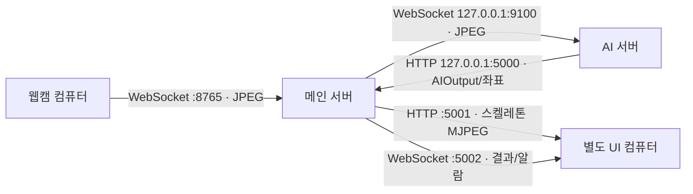

# DolBom 통합본: main 판단 로직 + WebSocket/HTTP 통신

이 통합본은 `deeplearning-repo-main.zip`의 모델 가중치, `fall_detector.py`, `gait_analyzer.py`, `stretching_manager.py`, `ai_manager.py`, `data_models.py`, `main_service/fall_analyzer.py`, `main_service/stretching_analyzer.py` 파일을 바꾸지 않고 사용합니다. `yolo_pose.py`는 기존 `detect()` 출력 그대로 유지하면서 마지막 관절 좌표를 통신 계층이 읽을 수 있게 보관하는 코드만 추가했습니다. `ai_service.py`, `ai_networkmanager.py`, `main_server/`, `config/settings.py`는 WebSocket·HTTP 계약에 맞춰 연결했습니다.

AI 서비스는 원본처럼 **카메라별 스레드와 AIManager 인스턴스 하나씩**을 유지합니다. 각 스레드에서 `get_frame(camera_id) → set_mode(mode) → process_frame(frame) → send_to_main(result)`를 순서대로 호출합니다. 통신용 프레임 보관만 카메라별 최신 1개로 제한하며, 지연 프레임·모드 변경·처리 오류에 따라 AIManager를 다시 만들지 않습니다. 영상이 밀리면 중간 프레임이 생략될 수 있으므로 원본 시간 모델의 입력 간격은 실제 영상으로 검증해야 합니다.

## 역할과 통신



| 담당 | 결과 |
|---|---|
| AI 서버 mode 0 | main 낙상 모델의 `detections[].raw_data.fall_prob` 원본 |
| AI 서버 mode 1 | main 보행 모델의 `disease_scores`, `cumulative_scores`, `gait_score` 원본 |
| AI 서버 mode 2 | main 스트레칭 모델의 `keypoints`, `limb_angles` **리스트**, `spread_distances` **리스트**, `confidence` 원본 |
| 메인 서버 mode 0 | 변경하지 않은 main `FallAnalyzer.analyze()`의 `normal`/`checking`/`alert`, track 상태, 이벤트 |
| 메인 서버 mode 1 | main에 최종 질환 선택 함수가 없으므로 누적 점수(없으면 실시간 점수)의 최대값을 `judgment.gait.people[].category`로 표시; 정상(`normal`)도 가능 |
| 메인 서버 mode 2 | 변경하지 않은 main `StretchingAnalyzer.analyze()`의 `overall_score`, `GOOD`/`ADJUST`/`CHECK` 등. 기준 동작 파일 필요 |

AI 모델의 `AIOutput`에는 main의 `frame_idx`와 `detections`가 그대로 남습니다. 통신 계층이 메인 서버의 정확한 원본 프레임을 찾도록 **별도** `frame_id`와 `skeletons`를 최상위 JSON에 추가합니다. `detections[].raw_data`는 수정하지 않습니다. 메인 서버의 최종 판단은 별도 `judgment` 필드에 붙이며 원본 AI 결과를 그대로 유지합니다.

```json
{
  "camera_id": "cam_01", "timestamp": "2026-09-29T02:00:00Z",
  "frame_idx": 0, "mode": 0,
  "detections": [{"track_id": 1, "bbox": [10, 10, 100, 200], "raw_data": {"fall_prob": 0.8, "confidence": 1.0}}],
  "frame_id": 123,
  "skeletons": [{"track_id": 1, "keypoints": [[10, 20], [11, 21]]}],
  "judgment": {"fall": {"camera_id": "cam_01", "camera_status": "alert", "tracks": [], "events": []}}
}
```

위 예시는 필드의 관계를 보여주기 위해 관절을 줄였습니다. 실제 `skeletons[].keypoints`는 사람당 COCO-17 순서의 **17개** `[x,y]` 픽셀 좌표입니다. `judgment`는 **메인 서버가 결과 수신 후** 추가합니다.

### main 원본 로직을 연결할 때 필요한 입력 뷰

main `StretchingManager`는 각도·거리 **리스트**를 반환하지만 main `StretchingAnalyzer`는 이름별 **딕셔너리**를 읽습니다. `main_server/policy.py`가 메인 서버 안에서만 결과의 **복사본**을 만들어 판단 함수에 넣습니다. HTTP로 받은 AI 원본, `/results`와 UI로 보내는 `detections[].raw_data`는 리스트 그대로입니다. 기준 자세는 픽셀 좌표로 공급하고, 메인 서버가 어깨 중심 좌표로 복사·정렬해서 main 판단 함수에 전달합니다. 판단 함수의 점수 계산 방식은 바꾸지 않았습니다.

`main_service/fall_analyzer.py`의 현재 창 비율 규칙은 고확률 샘플이 **첫 한 건뿐이어도 즉시 alert**가 될 수 있습니다. `alert`는 `resolve()` 호출 전까지 유지되는데, 이 통합본에는 resolve HTTP API가 없습니다. 동작을 임의로 수정하지 않았으므로 실제 알람 정책으로 사용하기 전에 팀에서 확인해야 합니다. 또한 main 운동 판단의 거리 점수 식 `100 - (dist_diff / 100) * 100`은 정규화된 거리 입력에 그대로 적용됩니다. 점수의 물리적 의미와 기준 데이터가 현장 영상에 맞는지 별도 검증이 필요합니다. 보행 최댓값은 모델 점수상 가장 큰 분류일 뿐 임상 진단이 아닙니다.

## 실행

같은 서버 컴퓨터의 두 터미널에서 프로젝트 루트 기준:

```bash
python -m pip install -r main_server/requirements.txt
python -m main_server.service
```

```bash
# 팀 모델의 PyTorch, Ultralytics, OpenCV가 설치된 AI 가상환경에서 실행
python -m pip install -r ai_server/requirements.txt
python -m ai_server.ai_service
```

카메라 컴퓨터에서 (메인 서버의 LAN IP 사용):

```bash
python -m pip install websockets opencv-python
python -m main_server.camera_example --url 'ws://서버IP:8765/cameras/cam_01?mode=0' --source 0
```

- `cam_01`~`cam_05`: 카메라 ID. ID마다 한 연결만 허용.
- `mode=0/1/2`: 낙상/보행/운동. 모드 변경은 다른 URL로 재연결.
- 내부 AI 입력: `ws://127.0.0.1:9100/frames`; 결과: `POST http://127.0.0.1:5000/ai_result`.
- UI: `http://서버IP:5001/preview/cam_01`, `/results/cam_01`, `/health`, `ws://서버IP:5002/ui`.
- 별도 PyQt UI가 있다면 `DOLBOM_VIEWER_URL=http://서버IP:5001 python -m dolbom`으로 실행할 수 있습니다. UI 코드는 이 ZIP에 포함하지 않았습니다.

운동 교정에는 기준 동작 JSON이 필요합니다. 예: `STRETCH_REFERENCE_PATH=/절대경로/reference.json python -m main_server.service`. 파일의 형식은 `{"movement_name":"...","skeletons":[{"frame_index":0,"keypoints":[[x,y], ... 17쌍],"confidence":[...]}]}`입니다. 파일이 없으면 `judgment.stretch.status=reference_missing`을 반환하고 **운동 성공/실패를 임의로 판단하지 않습니다**. `frame_index`는 해당 카메라·모드 세션의 AI `frame_idx`와 일치해야 합니다. 기준 자세 영상과 환자 영상의 시간 정렬은 아직 구현되지 않았습니다.

`/`의 `DASHBOARD_HTML`은 점검용입니다. 별도 UI는 위 영상·결과 주소에 접속합니다. JPEG 최대 2 MB, 카메라별 AI 입력 최신 1개, 메인에서 대응 프레임 최대 12개를 보관합니다. 포트 5000/9100은 loopback만 사용합니다. 카메라·UI 외부 포트에는 현재 인증/TLS가 없으므로 신뢰할 수 있는 네트워크에서만 사용하세요.

## 검증

```bash
PYTHONPATH=. python -m unittest discover -s tests -v
python -m compileall -q ai_server main_server main_service config
```

테스트는 **실제 가중치 추론이 아닌** 모의 프레임/결과로 WebSocket→HTTP→메인 판단→UI를 검증합니다. 이 환경에서는 PyTorch/Ultralytics를 설치·실행해 가중치 추론을 확인하지 못했습니다. 다섯 카메라의 처리량, 실제 FPS, 추적의 신뢰도, UI 컴퓨터의 렌더링은 별도 확인이 필요합니다.
