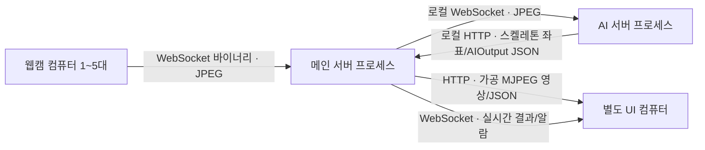
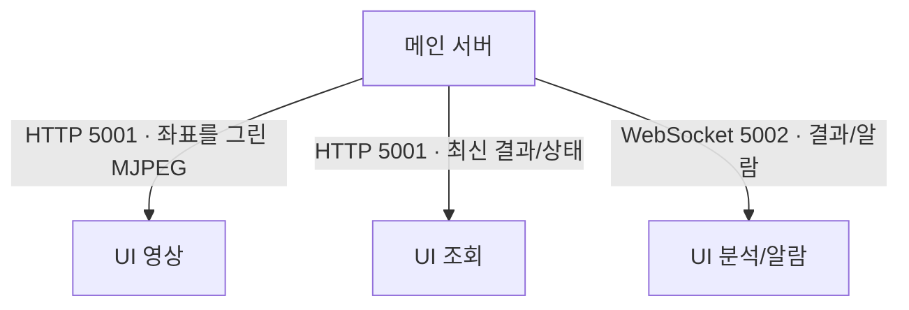

# deeplearning-repo-1

딥러닝 프로젝트 1조 저장소 · Dolbom

## 컴퓨터별 역할

| 장치 | 실행 프로그램 | 송신 | 수신 |
|---|---|---|---|
| 웹캠을 연결한 노트북/컴퓨터 | `main_server.camera_example` 또는 같은 규격의 카메라 송신기 | 웹캠 JPEG 영상 → 메인 서버 | AIOutput 등 **애플리케이션 데이터 수신 없음** |
| 서버 컴퓨터: 메인 서버 프로세스 | `main_server.service` | JPEG 프레임 → AI 서버; 메인 서버가 좌표를 그린 영상·결과 → UI | 카메라 영상; AI 스켈레톤 좌표·분석 결과 |
| 같은 서버 컴퓨터: AI 서버 프로세스 | `ai_server.ai_service` | 스켈레톤 좌표와 AIOutput JSON(HTTP) → 메인 서버 | 선택한 JPEG 프레임(WebSocket) |
| 별도의 UI 컴퓨터 | 웹브라우저 | 조회 요청 | 카메라 영상·분석 결과 텍스트 |

메인 서버와 AI 서버는 **같은 하드웨어의 별도 프로세스**로 실행하며 로컬호스트 WebSocket(메인→AI 영상)과 HTTP(AI→메인 좌표·결과)로 통신합니다. 카메라 노트북은 AI 분석 결과를 받지 않습니다. 카메라 연결은 영상 업로드만 담당합니다. WebSocket의 연결 유지에 필요한 프로토콜 제어 메시지는 별개입니다.



## 실행 방법

서버 컴퓨터의 프로젝트 최상위 디렉터리에서 메인 서버를 실행합니다.

```bash
python -m pip install -r main_server/requirements.txt
python -m main_server.service
```

같은 서버 컴퓨터의 별도 터미널에서, AI 모델 의존성이 준비된 환경으로 AI 서버를 실행합니다.

```bash
python -m ai_server.ai_service
```

웹캠이 연결된 컴퓨터에는 카메라 송신기에 필요한 패키지를 설치하고, **서버 컴퓨터의 IP 주소**로 접속합니다.

```bash
python -m pip install -r main_server/requirements.txt opencv-python
python -m main_server.camera_example \
  --url 'ws://서버IP:8765/cameras/cam_01?mode=0' \
  --source 0
```

UI 컴퓨터의 브라우저에서 `http://서버IP:5001/`을 엽니다. 카메라별 미리보기와 AI 결과 JSON을 확인할 수 있습니다. 현재 화면은 기본 점검용 대시보드이며 AI 좌표 결과가 도착해 메인 서버가 영상을 그린 뒤 표시됩니다.

## 연결 주소 및 데이터

| 구간 | 주소·프로토콜 | 데이터 |
|---|---|---|
| 웹캠 컴퓨터 → 메인 서버 | `ws://서버IP:8765/cameras/cam_01?mode=0` · WebSocket | JPEG 바이너리 메시지; 메시지당 최대 2MB |
| 메인 서버 → AI 서버 | `ws://127.0.0.1:9100/frames` · WebSocket | 바이너리 JPEG 프레임과 JSON 메타데이터 |
| AI 서버 → 메인 서버 | `http://127.0.0.1:5000/ai_result` · HTTP POST | `camera_id`, `frame_id`, `timestamp`, `mode`, `detections`, `skeletons`를 포함한 AIOutput JSON |
| 메인 서버 → UI 컴퓨터 | `http://서버IP:5001/` · HTTP | 메인 서버에서 좌표를 그린 MJPEG 영상과 1초 간격으로 조회한 최신 AI 결과 JSON |

카메라 ID는 `cam_01`부터 `cam_05`까지이며, 같은 ID에 두 송신기가 동시에 연결할 수 없습니다. `--source`는 웹캠 컴퓨터에서 열 기기 번호입니다. URL의 `mode`는 `0` 낙상, `1` 보행, `2` 운동 분석 중 하나입니다. 현재 카메라 연결 중에는 모드를 바꿀 수 없으며 변경하려면 다른 모드 URL로 다시 연결해야 합니다.

서버 컴퓨터 내부에서 `http://127.0.0.1:5000/ai_result`는 AI 결과를 받는 전용 주소입니다. 외부 UI용 `5001` 포트에는 `/health`, `/results/cam_01`, `/preview/cam_01` 및 기본 화면 `/`이 제공됩니다. `AI_VIDEO_URL`로 내부 AI WebSocket 주소를 바꿀 수 있습니다(기본값 `ws://127.0.0.1:9100/frames`).

## 처리 방식 및 현재 한계

메인 서버는 웹캠 프레임 수신 시각과 증가하는 `frame_id`를 붙이고, 카메라별 최신 프레임 하나만 대기시킵니다. AI 서버에는 **최대** 15 FPS를 목표로 전달하며 밀리거나 누락된 프레임을 다시 만들지 않습니다. AI 서버는 공용 YOLO 모델로 가능한 카메라 프레임을 배치 처리하고 카메라별 낙상·보행·운동 분석 상태를 유지합니다. 결과의 `frame_id`는 원본 프레임과 대응됩니다.

현재 영상 형식은 JPEG입니다. H.264 송수신, 서버 녹화, 이벤트 영속 저장, 사용자 인증, TLS, 운영용 UI는 아직 구현되지 않았습니다. 웹캠 수신 시각은 카메라 센서의 실제 촬영 시각과 다를 수 있습니다. 공개 네트워크에 카메라·UI 포트를 열기 전에는 인증과 암호화가 필요합니다.

15 FPS는 연동을 위한 초기 목표값입니다. 낙상·보행 모델의 학습 FPS가 이 값과 맞는지 확인되지 않았습니다. 실사용 전에는 모델 학습 FPS, 누락 시퀀스 처리, 사람 추적 안정성, 실제 GPU에서의 5대 동시 지연·처리율을 검증해야 합니다.

## 별도 PyQt UI 연결

메인 서버의 `http://서버IP:5001/preview/cam_01`~`cam_05`가 UI 영상 스트림(MJPEG)이며, `ws://서버IP:5002/ui`가 UI 전용 결과 스트림입니다. UI WebSocket에는 AIOutput JSON과 `type: event`인 별도 이벤트 JSON을 보냅니다. UI 연결에서는 데이터를 업로드하지 않습니다. 서버 PC 내부 메인↔AI 영상은 WebSocket 9100, 스켈레톤 좌표·분석 결과는 HTTP 5000을 사용합니다. UI에서 `DOLBOM_VIEWER_URL=http://서버IP:5001 python -m dolbom`으로 실행할 수 있습니다.

CCTV 모드에서 같은 사람의 `fall_prob >= 0.9`가 연속 3회일 때 30초 간격으로 `낙상 의심` **임시 기준** 이벤트를 보냅니다. 확정 낙상 진단이 아니므로 실환경 모델 검증 전 알람 기준과 현장 확인 절차를 별도로 검토해야 합니다. 메인 서버는 이 이벤트를 메모리에만 유지하며 재시작 시 소실됩니다.

## 내부 영상 WebSocket 메시지 형식

한 메시지는 `4바이트 빅엔디언 헤더 길이 + UTF-8 JSON 헤더 + JPEG 바이트`입니다. 메인→AI 헤더는 `camera_id`, `frame_id`, `capture_time`(Unix 초), `mode`(0/1/2)입니다. AI는 WebSocket으로 영상 메시지를 반환하지 않고 `POST /ai_result`에 같은 두 ID와 좌표 JSON을 보냅니다. WebSocket은 `127.0.0.1:9100`에만 바인딩하며 연결이 끊어지면 메인 서버가 다시 접속합니다. AI는 카메라당 최신 입력 한 장만 대기시키며 추론 결과 JSON만 반환합니다. 메인 서버는 보관 중인 동일 `frame_id`의 원본에 COCO-17 스켈레톤을 그린 뒤 UI에 MJPEG로 제공합니다. 원본 프레임이 이미 만료됐거나 ID가 맞지 않으면 해당 결과를 거부합니다.

### UI 별도 컴퓨터 통신



메인 서버가 생성한 영상에는 검출된 자세 점과 임시 추적 ID가 표시됩니다. 질환 확률과 낙상 판단 값은 별도 AIOutput JSON으로 전달하며, 영상과 결과의 시간 일치를 확인할 때는 `camera_id`와 `frame_id`를 비교해야 합니다.

### AI 결과 JSON의 스켈레톤 좌표

`skeletons`는 `[ {"track_id": 1, "keypoints": [[x, y], ...] } ]` 형식입니다. 한 사람당 픽셀 좌표 17개(COCO-17 순서)를 포함하며, 검출된 사람이 없을 때는 빈 배열입니다. AI 서버는 JSON만 보내고 영상을 인코딩하거나 선을 그리지 않습니다. 메인 서버가 일치하는 원본 프레임을 찾아 스켈레톤과 ID를 그립니다. 메인 서버 실행에는 `main_server/requirements.txt`의 OpenCV가 필요합니다.
